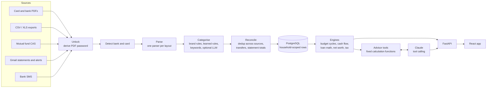

# artha-engine

A self-hosted finance engine for one or more households in India. It reads the statements and alerts
Indian banks send (credit-card PDFs, bank CSV/XLS exports, mutual-fund CAS PDFs, Gmail
statement mails, bank SMS), turns them into one de-duplicated ledger, categorises it, and computes
budgets, cash flow, loan payoff plans and net worth. An optional AI advisor answers questions about
that data.

I built it to run my own household's money and then made it multi-household. This repository is a
cleaned copy of that project: real statements, figures and names are removed, history starts fresh,
and the amounts in tests and code comments are illustrative (the arithmetic between them is kept).

The design rule that shapes everything: **every rupee figure comes from deterministic code.** The
language model categorises messy merchant text and explains numbers. It does not produce them.

## Quickstart

Needs Python 3.11+, Node 20 and PostgreSQL 14+ (Docker is easiest).

```bash
make up          # Postgres 16 in Docker on :5432
make venv        # backend/.venv + dependencies, copies .env.example to backend/.env
make demo        # runs migrations, loads a fictional household
make backend     # API on http://localhost:8000
make frontend    # web app on http://localhost:5173 (second terminal)
```

Log in as `demo@example.com` / `demo-password`. The demo household has four loans, eight cash-flow
lines and about 90 days of synthetic card and bank transactions from a fixed random seed
(`backend/scripts/seed_demo.py`). No API key is needed; without one every AI feature falls back to
the rules path.

To run the tests only:

```bash
make venv && make test
```

The suite uses in-memory SQLite and a stubbed model, so it needs no database, no network and no key.

## Architecture



**Ingest.** `services/ingest.py` is one pipeline shared by upload and Gmail pull:
bytes, unlock if encrypted, detect bank and card, parse, categorise, insert with de-duplication. It
returns a structured result per file instead of raising, so a batch sync reports per-file outcomes.
Encrypted PDFs can be opened by deriving the password from the holder's profile with the rule each
bank publishes (`parsers/pdf_password_rules.py`), so passwords need not be stored per card.

**Parse.** One module per real layout in `backend/parsers/` (HDFC CSV and PDF, ICICI PDF/XLSX/bank
XLS, Kotak PDF and bank CSV, Axis PDF, CAMS/KFintech CAS). Each was written against a real statement;
the layout tests use synthetic lines in the same shape. Bank SMS and alert mails go through
`services/extract.py`, which returns `None` for any field the text does not state instead of a default.

**Categorise.** `services/classifier.py` is the single path: canonical brand rules first, then rules
the user confirmed or the model learned, then keyword fallbacks. The optional LLM step
(`services/ai_categorize.py`) runs on the cheap model, sees only distinct descriptions, never sees
amounts, and can only pick from the fixed category list.

**Reconcile.** `services/dedup.py` treats "the same debit arrived by statement, SMS and email" as
record linkage (Fellegi-Sunter): block on amount and direction, score date proximity, counterparty
similarity (Jaro-Winkler), card and source, and merge only above a threshold. Same-amount payments to
two different people a minute apart stay separate. `services/reconcile.py` pairs transfers between
the household's own accounts so they count as neither income nor spend.

**Engines.** Billing-cycle budgets with weekly re-baselining (`services/cycle.py`), a backtested spend
projection (`services/projection.py`), amortisation, moratorium and prepayment math
(`services/loan_math.py`), payoff ordering (`api/debt.py`), capital gains and slab tax
(`services/capital_gains.py`, `services/tax.py`), XIRR, and net worth.
`services/consistency.py` holds cross-module invariants (for example, the cash-flow waterfall must
close, and the two asset queries must agree). They are served at `/api/consistency` and shown as a
self-check in the app.

## The model never produces a number

Money answers have to be right to the rupee, and language models round, transpose and invent. So the
advisor is split into three parts.

**1. Tool calling over fixed functions.** `services/advisor_agent.py` gives the model a short system
prompt and nine tools defined in `services/advisor_tools.py`: `actually_free`, `budget_status`,
`spend_by_category`, `emi_quote`, `affordability`, `debt_snapshot`, `networth_snapshot`,
`cashflow_snapshot` and `ground` (definitions from `backend/knowledge/`). Each tool calls the same
engine code the screens use. The prompt forbids quoting a figure not returned by a tool and routes
every EMI through `emi_quote`. `household_id` is not in any tool schema; `services/llm.run_tools`
injects it server-side on every call, so the model cannot ask for another household's data. The loop
is capped at six rounds and a 60 second timeout, and any failure returns no answer rather than a
partial one.

**2. A deterministic number verifier.** `evals/number_check.py` takes the answer text, the figures
the answer cited and the tools that were called, recomputes the ground truth from the database for
that household, and reports three kinds of violation:

- `hallucinated_number`: a cited figure that does not match the recomputed value (within Rs 2 or
  0.5%, or Rs 100 / 2% for figures the model displayed rounded, such as "Rs 1.5L").
- `gross_pool_as_free`: the answer calls the monthly budget pool "free" when most of it is already
  spent. This was the first real bug the advisor had. The parser understands lakh, crore and "k"
  shorthand so "Rs 1.5 lakh free" is caught the same way as "Rs 1,50,000 free".
- `contradiction`: "over budget" and "plenty free" in the same answer.

No model is involved, so the check is repeatable.

**3. An LLM judge that fails closed.** `evals/judge.py` scores what the verifier cannot: faithfulness
to the tool output, whether the advice is concrete rather than a reflexive "that's risky", and whether
it asked for or stated missing inputs. A missing key, a failed call, unparseable output or an
exception while building the prompt all return `pass: False, is_error: True`. A broken judge can
never read as a pass.

**Model split.** `config.py` names two models: a cheap fast one for categorisation and a stronger one
for the advisor and the judge. Both are settings, not code.

**What is and is not wired in.** The tool-calling advisor is behind `ADVISOR_GROUNDED=true`. The
default path is an older prompt that includes a precomputed snapshot of the same engine outputs plus
an EMI table, so the model still does not do arithmetic, but it is not tool-grounded. The verifier and
judge are evaluation components: 14 seed cases (7 at P0, where every case must pass) live in
`evals/cases_seed.py`, and both components are unit-tested, but the runner that replays those cases
against a live model is not in this repository, so I make no claim about pass rates here.

## Multiple households

Every domain table carries `household_id`. Isolation is enforced in several independent places, on
the assumption that any single one will eventually be forgotten:

- Request handlers get the household from the session, never from the client.
- `auth/permissions.py` declares every route in one table, and `auth/startup_check.py` refuses to
  start the app if any route is missing from it. Default is deny.
- `tests/test_every_route_is_scoped.py` checks that every route either takes a household or is on a
  named public list, and asserts it found a plausible number of routes (an earlier version silently
  checked 2 of 135).
- `tests/test_household_id_is_always_passed.py` walks the AST to find calls into household-scoped
  services that omit `household_id`.
- Background jobs (Gmail, SMS) have no session; `services/tenancy.py` makes "no household given" mean
  "the only household" and raises if there is more than one.
- `tests/test_tenant_isolation.py` creates two households and checks that listings, edits, deletes,
  budgets, duplicate previews, merges, undo and transfer pairing never cross between them.

Roles are `member`, `admin` and `super_admin` with per-area permission grants; a partial unique index
allows at most one super admin per household.

## Tests and CI

- 116 test files and about 1,000 tests. On a clean copy: `1010 passed` in about 15 seconds.
  None are skipped; tests that need Postgres-specific behaviour are not in the default suite.
- Many tests are regressions named after the bug they pin (for example
  `test_weekly_invariant_can_fail.py`, which feeds the invariant the exact shape that once shipped
  and requires it to go red).
- CI (`.github/workflows/ci.yml`) runs `ruff check` and `pytest` on the backend and a type-check and
  build on the frontend. It needs no secrets.
- 71 Alembic migrations. The later ones check the current schema before changing it, because one
  of them once failed against a database that was not in the state it assumed.

## Layout

```
backend/
  api/          FastAPI routers
  auth/         sessions, roles, the route permission registry, startup check
  parsers/      one module per statement layout
  services/     ingest, classify, dedup, cycles, loan math, advisor, consistency checks
  evals/        number verifier, LLM judge, seed cases
  knowledge/    definitions the advisor can look up
  alembic/      migrations
  scripts/      seed_demo, seed_household, user management
  tests/
frontend/       React + Vite + Tailwind
```

## Limitations

- Built for Indian banks, rupees and Indian tax rules. Parsers cover the layouts I had; another bank
  needs a parser, though the generic SMS and email path will often pick it up.
- The spend projection's constants were fitted on one household's ledger (the backtest is described in
  `services/projection.py`, but the data is private, so it cannot be reproduced from here).
- SMS capture reads the macOS Messages database and only works on a Mac with Full Disk Access.

## License

MIT. See [LICENSE](LICENSE).
